<div align="center">


# CSB 2.0

**Campus life, in one place.**

Notices, lost and found, lending, a marketplace and seven more services for
BUET students, behind one sign-in, with every post from someone on your campus.

[](https://github.com/Kairo-2081/CSB2.0/actions/workflows/ci.yml)
[](https://github.com/Kairo-2081/CSB2.0/actions/workflows/backup.yml)


[Live site](https://csb2-sg-yhv2.onrender.com/) ·
[Staging](https://csb2-staging.onrender.com/) ·
[Runbook](./docs/runbook.md) ·
[Launch checklist](./LAUNCH_CHECKLIST.md)

<picture>
<source media="(prefers-color-scheme: dark)" srcset="./.github/assets/readme/csb-home.jpg" />
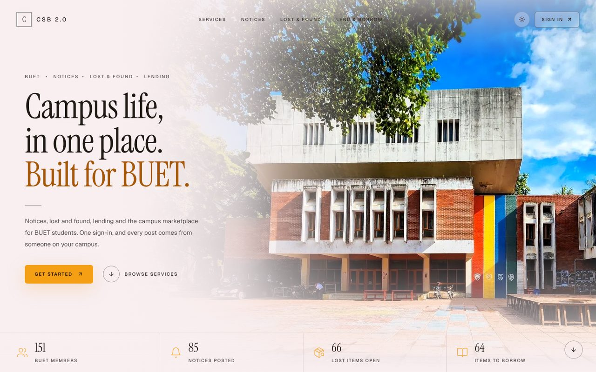
</picture>

</div>

<div align="center">

[Product tour](#product-tour) · [How a post moves](#how-a-post-moves) ·
[Campus assistant](#campus-assistant) ·
[Privacy and your data](#privacy-and-your-data) · [Data model](#data-model) ·
[Architecture](#architecture) · [Performance](#performance) ·
[Quality](#quality-and-safety) · [Get started](#get-started) ·
[Status](#project-status-and-next-steps)

</div>

CSB 2.0 brings the things students used to chase across Facebook groups,
notice boards and hall corridors into one place: official notices, lost and
found, lending and borrowing, a marketplace, complaints, bicycles, blood
donors, animal welfare, faculty suggestions and a student directory. Only
students with a university email can join, everyone sees only their own
campus, and administrators moderate what gets reported. It opens at BUET
first; other Bangladeshi universities come later.

## At a glance

| | |
| --- | --- |
| **Ten services, one sign-in** | Notices, lost and found, lend and borrow, marketplace, complaints, bicycles, blood donation, animal welfare, faculty suggestions and a student directory. Each can be switched off with one setting. |
| **Campus only** | Sign-up needs an `@buet.ac.bd` address, and every list shows posts from your own university only. |
| **The database decides** | All 56 data functions live in [`schema.sql`](./schema.sql) as PL/pgSQL. The API takes your identity from the session, never from the request, and the database checks campus, ownership and role. |
| **Moderation built in** | Any post can be reported; three reports hide it until an admin decides; admins can suspend accounts, and every step is logged. |
| **Campus assistant** | An optional AI helper (Groq) that searches your campus, drafts posts for you to check and post, explains how things work and, for admins, summarises activity. Phone numbers and emails never leave the server. |
| **Two themes** | Dark and a blush light mode, each board with its own colour, motion that switches off for reduced-motion users. |
| **Verified** | 60 API test cases, 7 Playwright tests including an axe scan of 15 pages in both themes, a nightly encrypted backup that is restored and checked every night. |

## Who does what

| Role | Gets | How you become one |
| --- | --- | --- |
| **Visitor** | The landing page with live campus counts, and the privacy notice | Anyone |
| **Student** | All ten services: post, borrow, report, find people; the campus assistant; a profile with contact privacy, data export and account deletion | Sign up with a university email at an open university |
| **Admin** | Everything a student has, plus notices, the campus overview charts, the moderation queue, suspensions, the moderation log and assistant summaries of campus activity | Set by another admin or the first-run `ADMIN_EMAIL`; there is no public admin sign-up |

## Try it

| Role | What you can try |
| --- | --- |
| Visitor | Open the [live site](https://csb2-sg-yhv2.onrender.com/) and the [privacy notice](https://csb2-sg-yhv2.onrender.com/privacy) without signing in. |
| Student | Sign up with an `@buet.ac.bd` address (subdomains such as `ugrad.cse.buet.ac.bd` count). |
| Admin | Not shared. |

No shared demo accounts are published. The live site currently holds invented
sample students (all with `@demo.invalid` addresses) while the pilot is
prepared; they are deleted before real students are invited.

## Product tour

The public pages, captured from a local build.

<div align="center">

<table>
<tr>
<td width="50%" valign="top">
<picture>
<source media="(prefers-color-scheme: dark)" srcset="./.github/assets/readme/csb-services.jpg" />
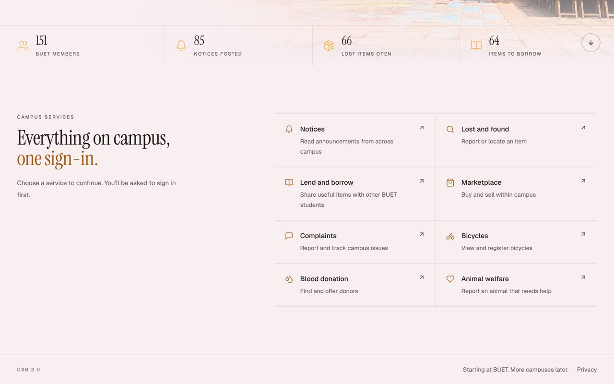
</picture>
<p><b>See every service.</b> The landing page lists what is open on campus and shows live counts once there is activity.</p>
</td>
<td width="50%" valign="top">
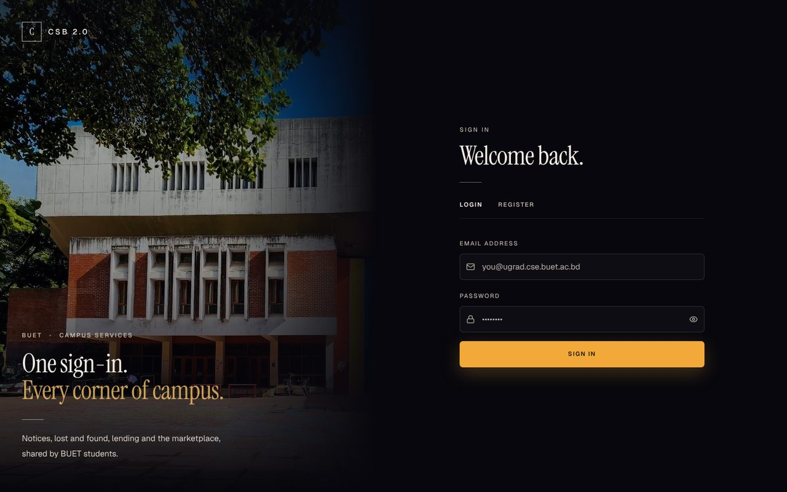
<p><b>Sign in or join.</b> One form for both. Sign-up asks for a university email, a department from BUET's list and consent to the privacy notice.</p>
</td>
</tr>
<tr>
<td colspan="2" valign="top">
<picture>
<source media="(prefers-color-scheme: dark)" srcset="./.github/assets/readme/csb-privacy.jpg" />
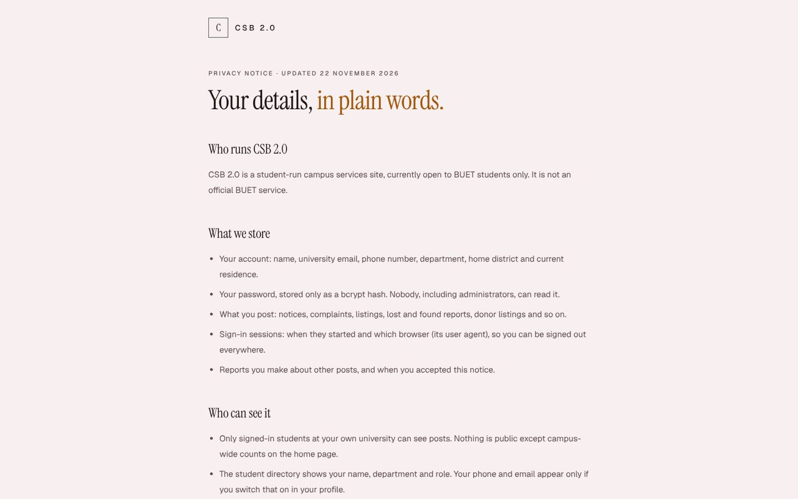
</picture>
<p><b>Read the privacy notice.</b> Plain language: who runs it, what is stored, who can see what, and how to download or delete your data.</p>
</td>
</tr>
</table>

</div>

### Inside each workspace

These screens are the real interface on sample data: a throwaway local
database filled by [`scripts/readme-sample-data.sql`](./scripts/readme-sample-data.sql)
(150 invented students and about a year of posts). Names, listings and phone
numbers are invented; numbers start with 010, which no Bangladeshi operator
uses. Nothing comes from a real account, and
[`scripts/capture-readme-screens.mjs`](./scripts/capture-readme-screens.mjs)
regenerates every image.

#### Student

<table>
<tr>
<td width="50%" valign="top">
<picture>
<source media="(prefers-color-scheme: dark)" srcset="./.github/assets/readme/app-dashboard.jpg" />
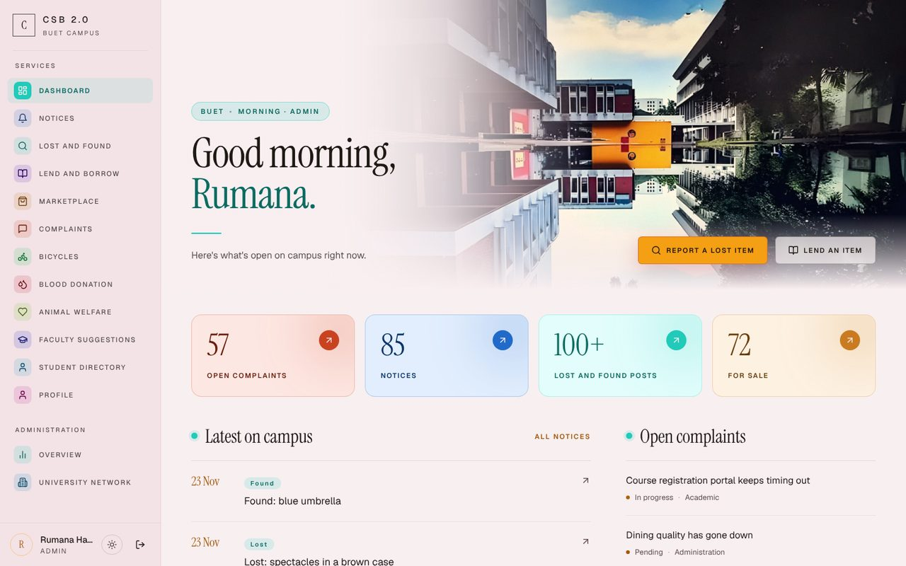
</picture>
<p><b>Start from the dashboard.</b> What is open on campus right now, the latest notices and open complaints. Each card takes the colour of its board.</p>
</td>
<td width="50%" valign="top">
<picture>
<source media="(prefers-color-scheme: dark)" srcset="./.github/assets/readme/app-notices.jpg" />
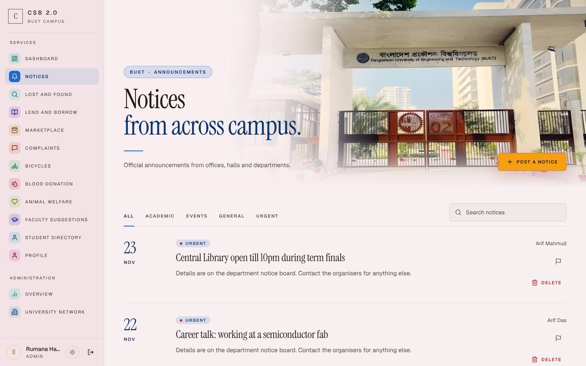
</picture>
<p><b>Read the notices.</b> Official announcements from offices, halls and departments, by category. Only admins post them.</p>
</td>
</tr>
<tr>
<td width="50%" valign="top">
<picture>
<source media="(prefers-color-scheme: dark)" srcset="./.github/assets/readme/app-lost-found.jpg" />
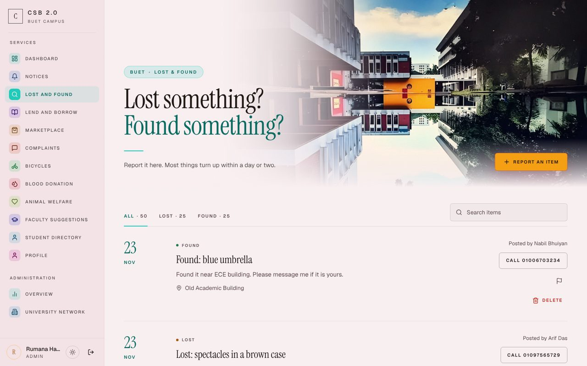
</picture>
<p><b>Find what was lost.</b> Lost and found posts with where it happened and a way to reach the poster.</p>
</td>
<td width="50%" valign="top">
<picture>
<source media="(prefers-color-scheme: dark)" srcset="./.github/assets/readme/app-marketplace.jpg" />
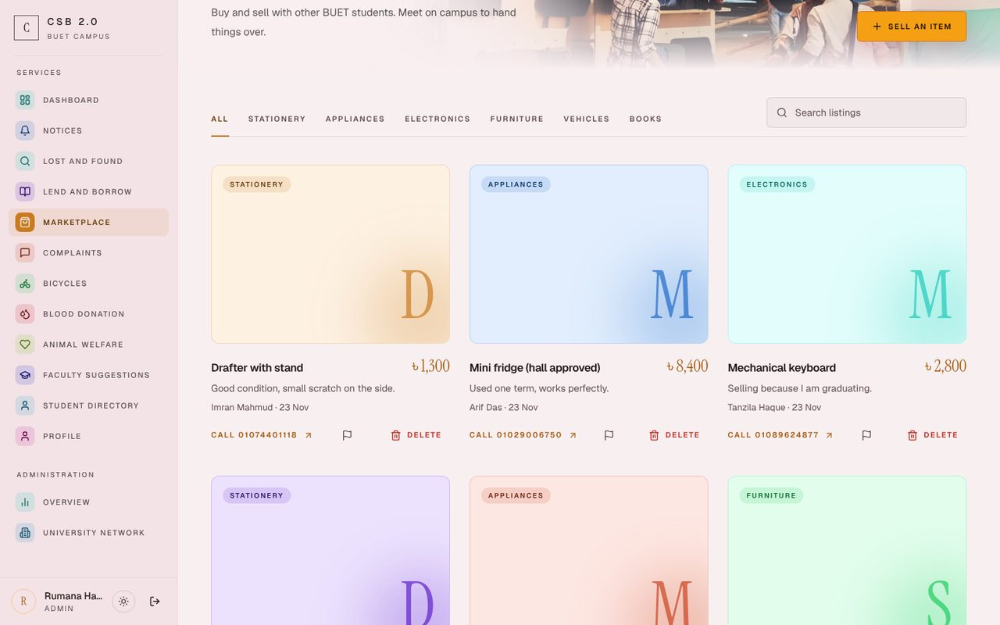
</picture>
<p><b>Buy and sell on campus.</b> Listings by category and price; meet on campus to hand things over.</p>
</td>
</tr>
<tr>
<td width="50%" valign="top">
<picture>
<source media="(prefers-color-scheme: dark)" srcset="./.github/assets/readme/app-lend-borrow.jpg" />
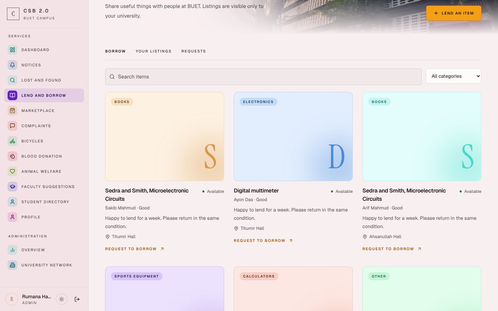
</picture>
<p><b>Lend and borrow.</b> Offer a textbook or a multimeter, request one, and the owner approves and marks it returned.</p>
</td>
<td width="50%" valign="top">
<picture>
<source media="(prefers-color-scheme: dark)" srcset="./.github/assets/readme/app-complaints.jpg" />
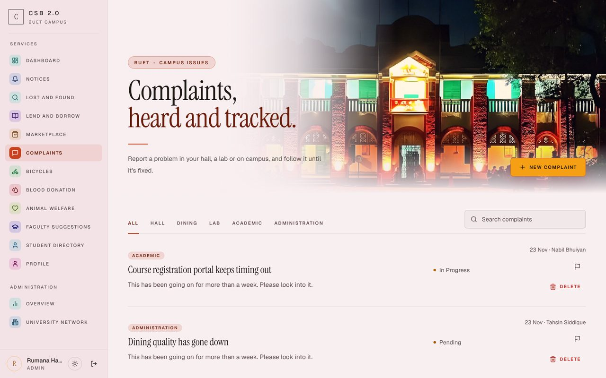
</picture>
<p><b>Raise a complaint.</b> By category, with a status you can follow. Complaints and faculty suggestions can be posted anonymously.</p>
</td>
</tr>
<tr>
<td width="50%" valign="top">
<picture>
<source media="(prefers-color-scheme: dark)" srcset="./.github/assets/readme/app-blood-donation.jpg" />
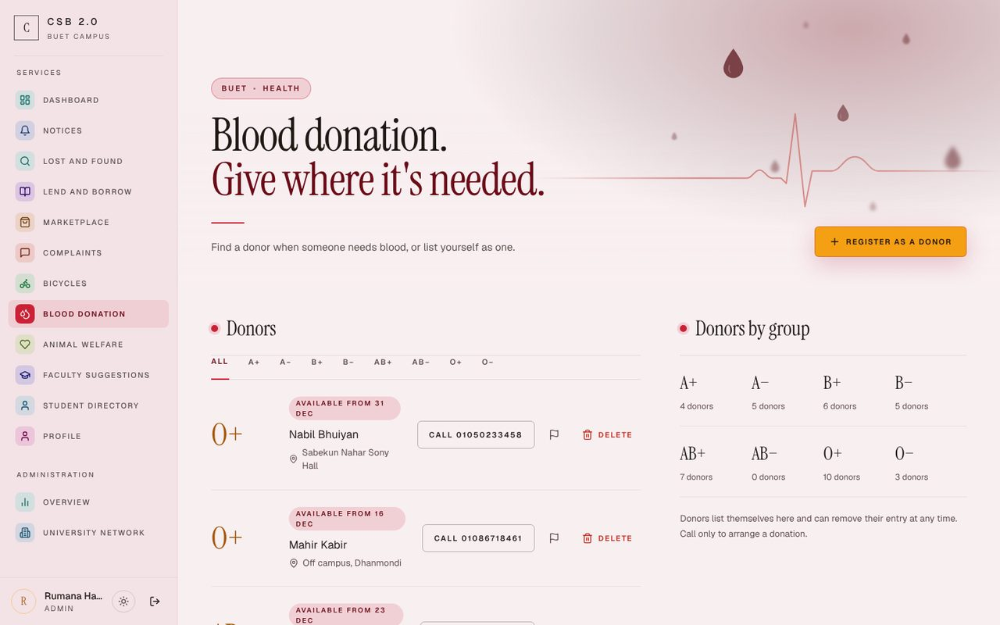
</picture>
<p><b>Find a blood donor.</b> Donors list themselves by group and availability, with explicit consent; anyone can remove their entry.</p>
</td>
<td width="50%" valign="top">
<picture>
<source media="(prefers-color-scheme: dark)" srcset="./.github/assets/readme/app-profile.jpg" />
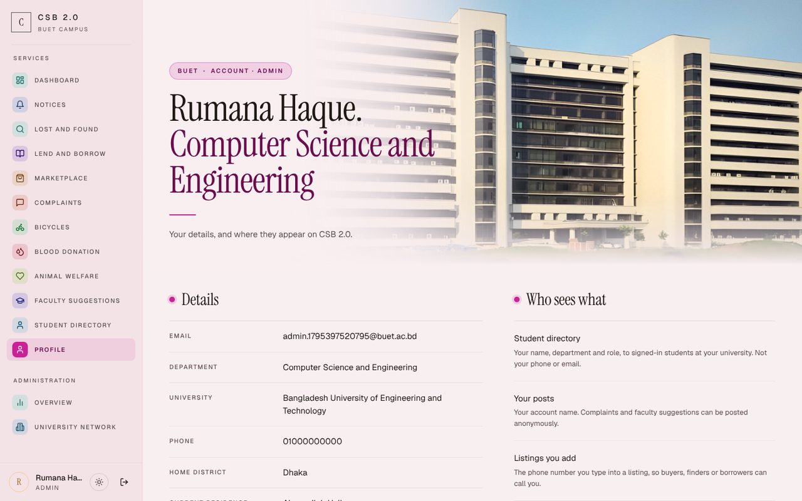
</picture>
<p><b>Control your details.</b> Choose whether the directory shows your phone and email, change your password, download your data or delete the account.</p>
</td>
</tr>
</table>

#### Campus assistant

<table>
<tr>
<td colspan="2" valign="top">
<picture>
<source media="(prefers-color-scheme: dark)" srcset="./.github/assets/readme/app-assistant.jpg" />
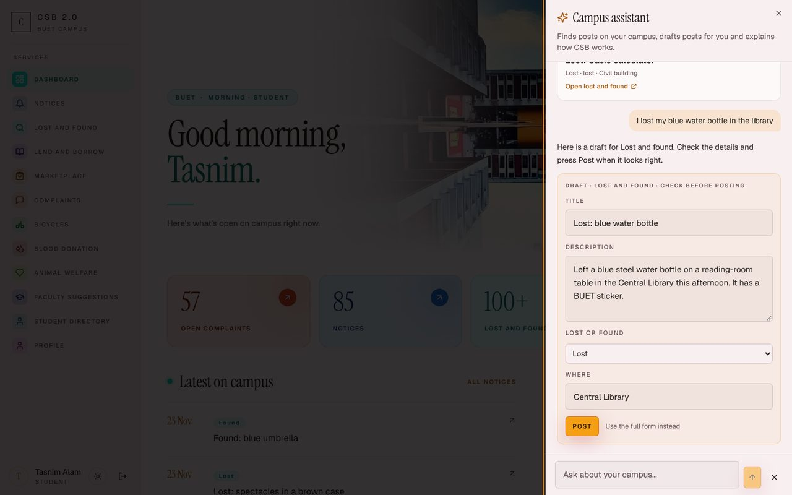
</picture>
<p><b>Ask, find, draft.</b> Matching posts come back as cards that open their board, and a request to post becomes a draft to check and post yourself. Captured locally with a stand-in model, so the reply wording is scripted; the posts found and the draft form are the real app.</p>
</td>
</tr>
</table>

#### Admin

<table>
<tr>
<td colspan="2" valign="top">
<picture>
<source media="(prefers-color-scheme: dark)" srcset="./.github/assets/readme/app-admin.jpg" />
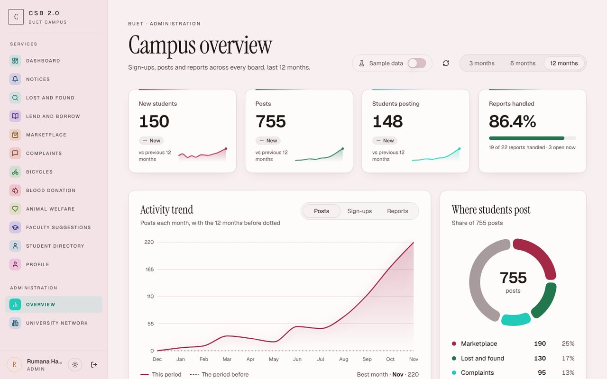
</picture>
<p><b>Read the campus.</b> New students, posts, students posting and reports handled over 3, 6 or 12 months, each against the period before; a monthly trend, where students post, posts by weekday and the busiest boards. Everything is computed by one database function for the admin's own university.</p>
</td>
</tr>
<tr>
<td colspan="2" valign="top">
<picture>
<source media="(prefers-color-scheme: dark)" srcset="./.github/assets/readme/app-central-admin.jpg" />
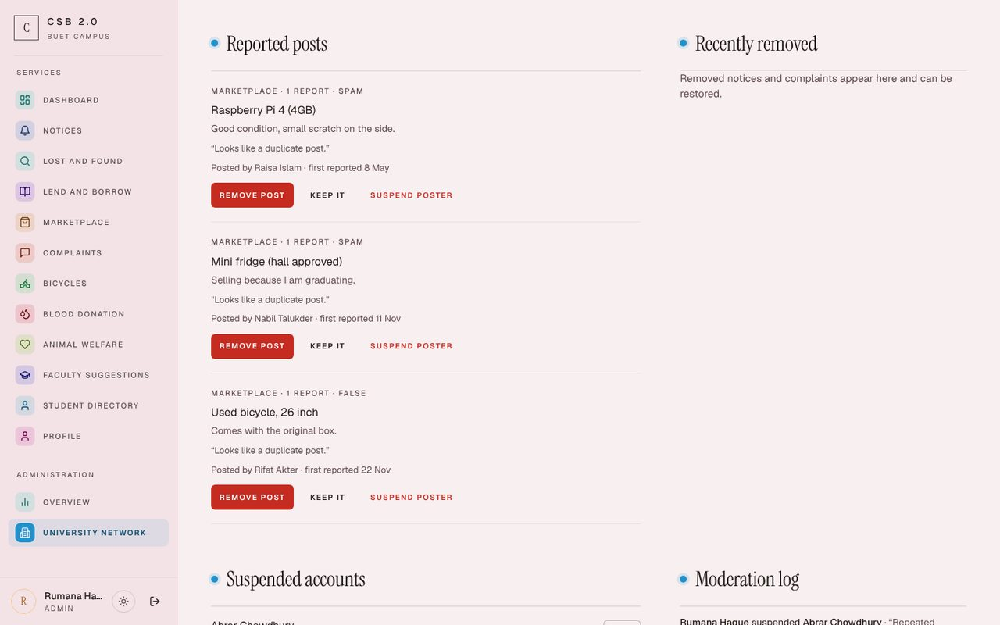
</picture>
<p><b>Moderate.</b> Reported posts grouped with their reasons; remove, keep or suspend the poster. Suspended accounts can be lifted, removed notices and complaints restored, and every step lands in the moderation log.</p>
</td>
</tr>
</table>

#### On a phone

<table>
<tr>
<td width="50%" align="center" valign="top">
<picture>
<source media="(prefers-color-scheme: dark)" srcset="./.github/assets/readme/phone-dashboard.jpg" />
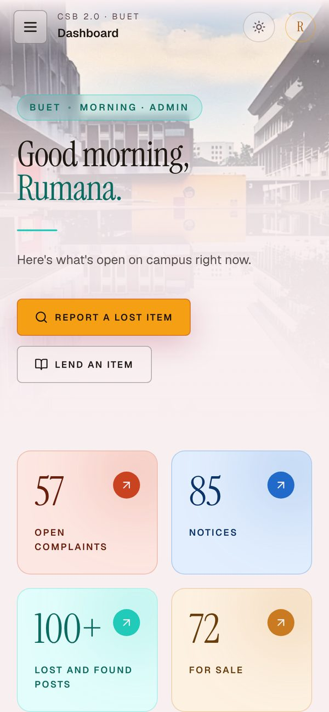
</picture>
<p><b>Same app, narrow screen.</b> The dashboard at 390 × 844.</p>
</td>
<td width="50%" align="center" valign="top">
<picture>
<source media="(prefers-color-scheme: dark)" srcset="./.github/assets/readme/phone-marketplace.jpg" />
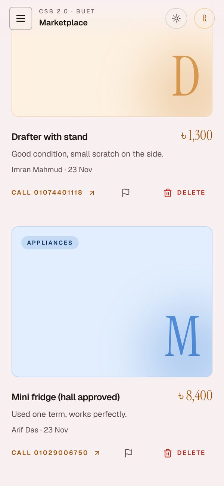
</picture>
<p><b>Listings.</b> One column, with price, seller and a call button.</p>
</td>
</tr>
</table>

## How a post moves

A post is visible only to the poster's university. Reports, hiding, removal
and suspension follow this path; the API tests in
[`tests/api/moderation-tools.test.js`](./tests/api/moderation-tools.test.js)
walk it end to end.

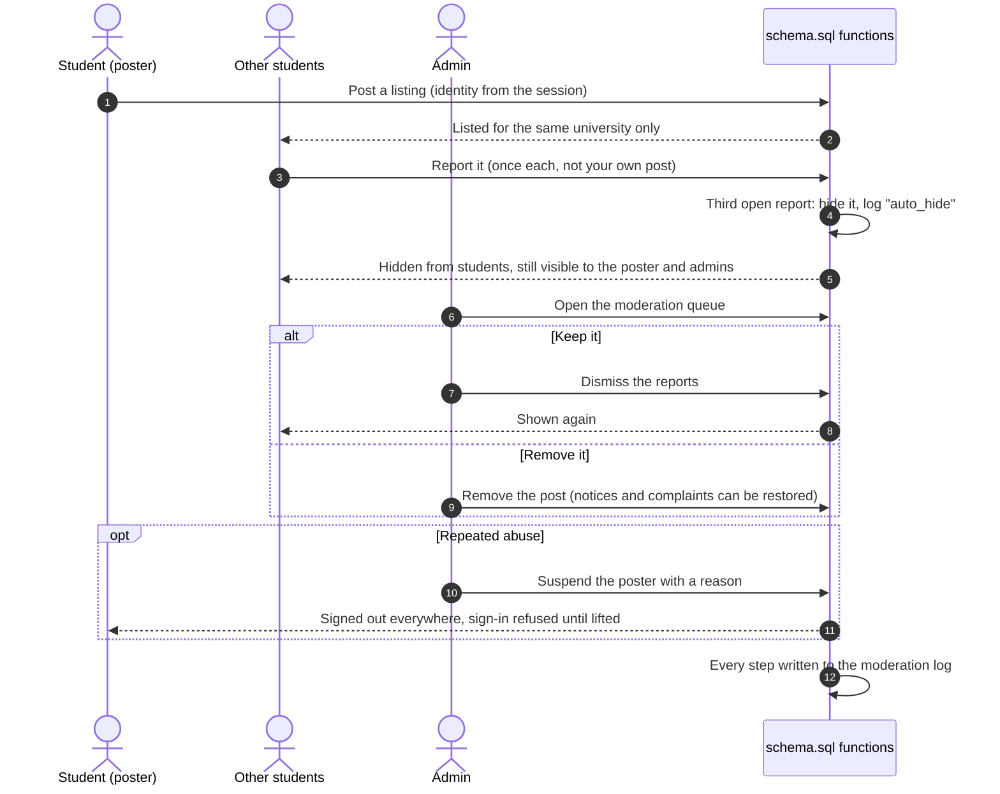

### Statuses

Values marked with a `CHECK` constraint cannot be anything else; the
database functions decide which changes are allowed.

| Thing | Statuses | Notes |
| --- | --- | --- |
| Report | `open` → `dismissed` · `removed` (`CHECK`) | One report per student per post |
| Post visibility | visible → hidden (3 open reports) → visible · removed | `hidden_at` on every board table |
| Notice, complaint | live → removed → restored | Soft-deleted, so an admin can restore |
| Complaint | `pending` → `in_progress` → `resolved` | Shown with each complaint |
| Lending item | `available` · `borrowed` (`CHECK`) | |
| Borrow request | `pending` → `approved` · `declined` → `returned` (`CHECK`) | One open request per item and student |
| Bicycle | `available` · `rented` · `maintenance` (`CHECK`) | |
| Lost and found post | `lost` · `found` (`CHECK`) | |
| Account | active → suspended → active | Suspension revokes every session |
| Email | unverified → verified | Six-digit code; required only when mail is configured |

## Campus assistant

> **Status:** built and tested against a stand-in provider; switched on in
> production once a `GROQ_API_KEY` is set on Render.

An "Ask CSB" button on every signed-in page opens a chat. The model (Groq,
`llama-3.3-70b-versatile` by default) never touches the database; it asks the
server to run one of three tools, and the server decides what it may see.

| Tool | What it does | Who |
| --- | --- | --- |
| `search_posts` | `assistant_search` in `schema.sql`: matching posts at your university that you could already see, without phone numbers, emails or user ids | Everyone |
| `draft_post` | Fills a post for lost and found, marketplace, complaints, animal welfare, faculty suggestions or lending (notices for admins), checked with the form's own schema. It comes back as an editable draft; you press Post | Everyone |
| `campus_summary` | The campus overview and open reports, condensed | Admins |

The prompt carries a short guide to how CSB works, answers in English or
Bangla, and treats post text as data, never as instructions. Limited to 30
questions per student per 10 minutes; the server logs which tools ran and the
token count, never the conversation. Tests in
[`tests/api/assistant.test.js`](./tests/api/assistant.test.js) use a fake
provider to check that other campuses, hidden posts, phone numbers, emails and
user ids never reach it.

## Privacy and your data

> **Status:** the privacy notice is written in plain language but has not yet
> had a legal read for Bangladesh. That is a launch gate in
> [`LAUNCH_CHECKLIST.md`](./LAUNCH_CHECKLIST.md).

| What | How it works |
| --- | --- |
| **Who can see you** | Only signed-in students of your university. The directory shows your name and department; phone and email only if you switch them on. |
| **Consent** | Required at sign-up, and again for every blood-donor listing. |
| **Anonymous posts** | Complaints and faculty suggestions can hide your name. The server still records who posted, for ownership and moderation. |
| **Your data** | Profile → Download my data gives a JSON copy of your account and posts (never the password hash). Delete my account removes the account and everything you posted; the last admin cannot delete themselves. |
| **Passwords and sessions** | bcrypt hashes (cost 12); sessions are an HttpOnly cookie and only a SHA-256 of the token is stored. |
| **Campus assistant** | Optional. Questions, the conversation and matching posts go to Groq (United States); phone numbers, emails and account ids are removed first, and only posts you could already see are searched. Conversations are not kept; the assistant never posts for you. |
| **Error reports** | Browser errors are logged with your user id if you were signed in, so a broken page can be followed up. Nothing else is tracked. |

## Data model

17 tables and 31 foreign keys in one file, [`schema.sql`](./schema.sql), built
by 4 numbered migrations that only ever roll forward.

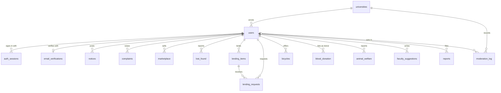

| Domain | Tables | What it holds |
| --- | --- | --- |
| Identity and access | `universities`, `users`, `auth_sessions`, `email_verifications` | Who can sign in, at which university, and their sessions |
| Boards | `notices`, `complaints`, `faculty_suggestions`, `marketplace`, `lost_found`, `bicycles`, `blood_donation`, `animal_welfare` | Every post, each with `university_id`, its owner and `hidden_at` |
| Lending | `lending_items`, `lending_requests` | What is offered and who asked for it |
| Moderation | `reports`, `moderation_log` | Reports per post, and every action taken |
| Schema | `schema_migrations` | Which numbered migrations have run |

Design choices worth knowing:

- **One file, one source of truth.** Every table, migration and function is in `schema.sql`. The server applies it at start-up inside one transaction; functions are dropped and recreated, migrations run once and are recorded.
- **The server calls functions only.** Each route validates the body with zod and calls one `SELECT fn(...)`. Functions return JSON and raise `CSnnn` errors that map to HTTP status `nnn`.
- **Identity comes from the session.** `actor()` loads the signed-in user (and refuses suspended ones); no function trusts a user id from the request.
- **Soft delete where restoring matters.** Notices and complaints keep `deleted_at` so admins can restore them; other boards delete for real.

## Performance

Measured on the production build of 23 Nov 2026 (`npm run build`):

| What loads | Size | Gzipped |
| --- | --- | --- |
| Main JavaScript (landing page and shell) | 342 kB | 110 kB |
| CSS | 106 kB | 18 kB |
| Each board page, loaded on demand | 4 to 37 kB | 1 to 13 kB |
| Admin overview with charts, loaded only on `/admin` | 455 kB | 122 kB |

Every page except the landing page loads on demand, so students never download
the charting code. **Read with care:** these are file sizes, not load times.
No phone or Lighthouse timing has been recorded yet, and the free Render plan
sleeps when idle, so the first visit after a quiet spell takes up to a minute.

## Quality and safety

| Area | What is in place |
| --- | --- |
| **Tests** | 60 API test cases in 10 files against a real PostgreSQL, one for every access rule; 7 Playwright tests: sign-up to sign-out, ownership, privacy, the retry state and the accessibility scan |
| **Accessibility** | axe (WCAG 2.1 A and AA) over the 3 public pages and all 12 signed-in pages, in dark and light, on every CI run; serious or critical problems fail the build |
| **API access** | Default deny: only the routes in `PUBLIC_ROUTES` work without a session, and a test walks the router to prove it |
| **Sessions** | HttpOnly, SameSite=Lax cookie (Secure in production), hashed at rest, 7-day expiry, revoked on sign-out, password change and suspension |
| **Hardening** | helmet with a strict CSP, a CORS allowlist, an Origin check on writes, a 50 kB body limit, rate limits (8 sign-ins per 15 minutes, 10 sign-ups per hour, 300 requests per minute), generic 500s with a request id |
| **CI checks** | Lint with zero warnings, type check, build, `npm audit` at high severity, gitleaks secret scan, both test suites, then deploy |
| **Errors** | Server errors and browser crashes go to one JSON log with a request id, the page and the build; a crashed page shows a way out instead of a blank screen |
| **Backups** | Neon point-in-time restore, plus a nightly encrypted `pg_dump` that is restored into a scratch PostgreSQL and checked every night |

### Launch evidence

| Check | Result |
| --- | --- |
| **Restore drill** | 22 Nov 2026: production restored from a Neon snapshot into a new branch in under a minute; tables, users and posts matched. Logged in [`docs/evidence/restore-log.md`](./docs/evidence/restore-log.md) |
| **Nightly backup** | Green on [22 Nov](https://github.com/Kairo-2081/CSB2.0/actions/runs/45044111585) and [23 Nov](https://github.com/Kairo-2081/CSB2.0/actions/runs/45092018455), each dump restored and checked |
| **Live access probe** | Every protected route on production answered 401 without a session |
| **axe** | No serious or critical violations on 15 pages in both themes |

What this does not prove yet:

| Item | Status |
| --- | --- |
| Someone other than the author trying to break it (OWASP ZAP baseline or a friend) | **Not done** |
| Legal read of the privacy notice | **Not done** |
| Email verification codes in production | **Built and tested; waiting on the Brevo account** |
| Branch protection on `main` | **Not set** |
| A deliberate rollback drill | **Not done** |
| Load time on a real phone | **Not measured** |

## Engineering

### Technology

| Layer | Technology |
| --- | --- |
| Web app | React 18, Vite, TypeScript, Tailwind, shadcn/ui, Recharts |
| API | Node.js 22, Express, zod |
| Database | PostgreSQL with PL/pgSQL; Neon in production |
| Authentication | Hashed session tokens in an HttpOnly cookie |
| Email | Brevo HTTPS API (or SMTP where the host allows it) |
| AI | Groq chat completions with tool calling |
| Testing | Node.js test runner, Playwright, axe-core |
| Hosting | Render web service in Singapore, Neon PostgreSQL in Singapore |
| CI | GitHub Actions with PostgreSQL |

### Decisions and trade-offs

- **All data logic in the database.** Access rules sit next to the data they guard, so a new route cannot forget a check. The cost: changes need PL/pgSQL, and the database does work an ORM would do in the server.
- **The schema applies at start-up.** Simple to run anywhere (one file, no migration tool). The cost: a bad migration stops the server starting, so migrations are tested in CI against a real PostgreSQL, and the runbook says to take a Neon snapshot branch before a risky one reaches production.
- **Campus scope everywhere.** Every row has a `university_id` and every list filters by the viewer's. Opening a second university is a configuration change, not a rewrite.
- **Moderation before scale.** Reports, auto-hide, suspensions and a log exist before the pilot, because a campus board without them fills with spam fast.
- **The AI never touches the database.** The model can only ask for three tools; the server runs them as the signed-in student and strips contact details. The cost: answers are only as good as a keyword search, not a semantic one.
- **In-house error reporting.** Browser errors go to the same log as server errors instead of a third-party tracker. No account or extra privacy notice is needed; the cost is no dashboard or alerting.
- **Free tier first.** Render's free plan sleeps when idle and blocks SMTP, so mail goes over Brevo's HTTPS API and the first visit after a quiet spell is slow. A paid plan removes both at launch.

### Architecture

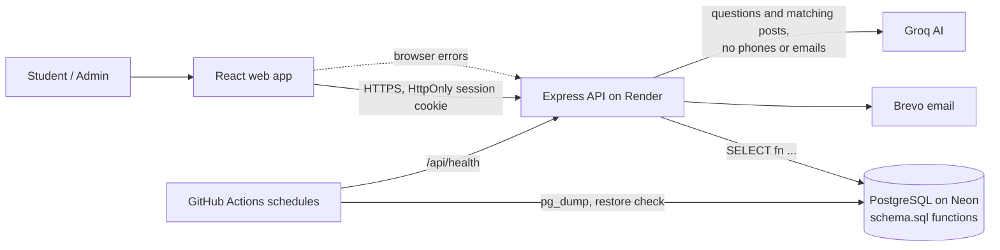

### Delivery pipeline

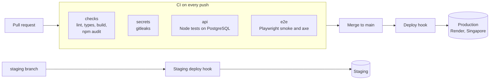

A push to `main` deploys production only after all four CI jobs pass; a push to
`staging` deploys the staging service, which has its own Neon branch. Rollback
is a redeploy of an earlier commit from the Render dashboard; see the
[runbook](./docs/runbook.md).

### Scheduled jobs

| Job | When | What it does |
| --- | --- | --- |
| Nightly backup | Daily, 20:30 UTC (02:30 in Dhaka) | Encrypted `pg_dump` kept for 30 days, then restored into a scratch PostgreSQL and checked |
| Uptime check | Every 6 hours | Calls `/api/health` and fails (emailing the owner) if the site or database is down |
| Dependabot | Weekly (npm), monthly (Actions) | Opens dependency update pull requests |

## Get started

### Requirements

- Node.js 22
- PostgreSQL 14 or newer

### Install

```sh
git clone https://github.com/Kairo-2081/CSB2.0.git
cd CSB2.0
npm ci
createdb csb2
cp .env.local.example .env.local     # set DATABASE_URL
npm run dev                          # API on :3001, site on :8080 (Vite proxies /api)
```

The server applies `schema.sql` on every start; it is safe to re-run. Register
with an `@buet.ac.bd` address. No accounts are seeded. To make yourself an
administrator, set `ADMIN_EMAIL` and `ADMIN_PASSWORD` before the first start
(that account must change its password at first sign-in), or run:

```sql
UPDATE users SET role = 'admin' WHERE lower(email) = lower('you@ugrad.cse.buet.ac.bd');
```

For a local database that looks lived in, load the sample data into a
throwaway database (never production):

```sh
psql postgresql://localhost/csb2 -f scripts/readme-sample-data.sql
```

### Environment variables

| Variable | Default | Purpose |
| --- | --- | --- |
| `DATABASE_URL` | `postgresql://localhost:5432/csb2` | PostgreSQL connection string |
| `NODE_ENV` | | `production` turns on Secure cookies and trusts one proxy |
| `OPEN_UNIVERSITIES` | `buet` | University slugs that may register |
| `ALLOWED_EMAIL_DOMAINS` | `buet.ac.bd` | Email domains allowed at sign-up |
| `MODULES` | all ten | Comma-separated services to switch on |
| `BREVO_API_KEY`, `MAIL_FROM` | | Mail through Brevo's HTTPS API; turns on email verification. Use this on Render's free plan, which blocks SMTP |
| `SMTP_URL` | | Mail over SMTP instead, where the host allows it |
| `REQUIRE_EMAIL_VERIFICATION` | on when mail is configured | Override the above |
| `ADMIN_EMAIL`, `ADMIN_PASSWORD` | | Create the first administrator once |
| `CORS_ORIGINS` | none in production | Other origins allowed to call the API |
| `DATABASE_SSL` | | `true` to force TLS when the URL lacks `sslmode` |
| `VITE_PRIVACY_CONTACT` | | Contact address shown on the privacy page (build time) |
| `GROQ_API_KEY` | | Switches on the campus assistant |
| `GROQ_MODEL`, `GROQ_BASE_URL` | `llama-3.3-70b-versatile`, Groq's API | Model and any OpenAI-compatible endpoint |
| `ASSISTANT` | | `off` switches the assistant off without removing the key |
| `RATE_LIMIT_ASSISTANT` | `30` | Questions per student per 10 minutes |

All settings are read in [`server/config.js`](./server/config.js); the example
file is [`.env.local.example`](./.env.local.example). Never commit `.env.local`.

### Tests

```sh
createdb csb2_test
TEST_DATABASE_URL=postgresql://localhost/csb2_test npm test   # API tests (wipes that database)

npm run build
DATABASE_URL=postgresql://localhost/csb2_e2e PORT=3001 node server.js &
npm run test:e2e                                              # Playwright smoke and axe
```

Point tests at a throwaway database only. CI provisions its own PostgreSQL.

### Useful commands

| Command | What it does |
| --- | --- |
| `npm run dev` | Starts the API and the web app with live reload |
| `npm run build` / `npm start` | Builds the app, then serves the production build |
| `npm run lint` | ESLint over the whole project (CI allows zero warnings) |
| `npm test` | Runs the API test suite against `TEST_DATABASE_URL` |
| `npm run test:e2e` | Runs the Playwright tests, including the axe scan |
| `npm run db:reset` | Drops and rebuilds your local database; refuses hosted databases |
| `node scripts/capture-readme-screens.mjs` | Regenerates the screenshots in this README from a throwaway local database |

### Documentation map

| If you want to… | Read |
| --- | --- |
| Run, deploy, roll back or restore | [`docs/runbook.md`](./docs/runbook.md) |
| Know what must be true before the pilot and launch | [`LAUNCH_CHECKLIST.md`](./LAUNCH_CHECKLIST.md) |
| See the restore evidence | [`docs/evidence/restore-log.md`](./docs/evidence/restore-log.md) |
| Understand the visual system | [`DESIGN.md`](./DESIGN.md) |
| Understand what the product promises | [`PRODUCT.md`](./PRODUCT.md) |
| Change the database | [`schema.sql`](./schema.sql): add a numbered migration block, never edit an applied one, and add an API test for every new access rule |

### Project layout

```text
src/
  pages/              One page per service, plus the landing page, sign-in, profile, admin
  components/         layout/ (sidebar, page header), admin/ (overview, moderation),
                      assistant/ (the chat panel), editorial.tsx (shared lists and states),
                      motion/, theme/, ui/
  lib/                API client, board colours, overview formats, error reporting
  services/           Typed calls to the API
server.js             Starts the server and applies schema.sql
server/
  app.js              Routes, middleware, the public-route allowlist
  config.js           Every environment setting
  schemas.js          zod request schemas
  mailer.js           Brevo or SMTP mail
  assistant.js        The campus assistant: prompt, tools, Groq calls
schema.sql            Tables, 4 migrations and 56 PL/pgSQL and SQL functions
tests/api/            Node test-runner tests against a real PostgreSQL
tests/e2e/            Playwright smoke and accessibility tests
scripts/              Database reset, sample data, README captures
docs/                 Runbook and launch evidence
.github/workflows/    CI and deploy, nightly backup, uptime check
```

## Project status and next steps

- **Pilot at BUET:** planned for January 2027 with two admins and invited students. Gates are in [`LAUNCH_CHECKLIST.md`](./LAUNCH_CHECKLIST.md).
- **Before real students:** delete the sample accounts, switch on email codes (Brevo), decide whether to switch on the assistant (Groq key), get a legal read of the privacy notice, and wipe the copy of real accounts on staging.
- **Before the campus launch:** an outside security pass, a deliberate rollback drill, branch protection on `main`, and a load-time check on a real phone.
- **Later:** a second university, once 30 days of launch numbers look right.

### Repositories

`Kairo-2081/CSB2.0` is where development happens; `unthinkingFool/CSB2.0` is
the upstream it was forked from and merges its `main` periodically. Open pull
requests against `Kairo-2081/CSB2.0`.

### AI-tool use

AI coding tools were used for implementation and documentation assistance.
Generated suggestions were reviewed and tested; the project maintainers remain
responsible for understanding and explaining the authentication, moderation
and data-handling code.

## License

No license has been chosen yet, so all rights are reserved by default. Add a
`LICENSE` file before inviting outside contributions.
